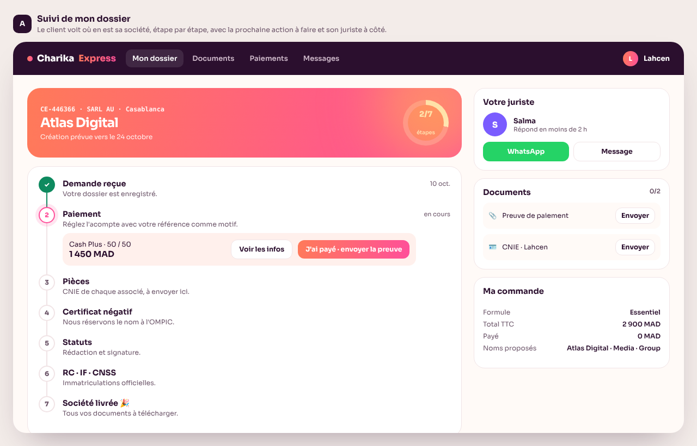
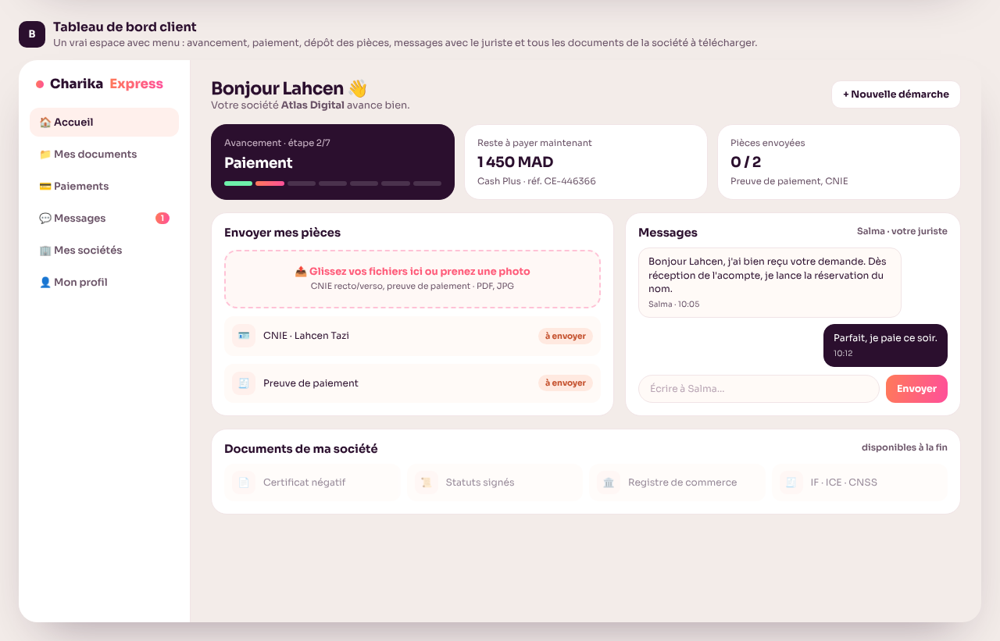
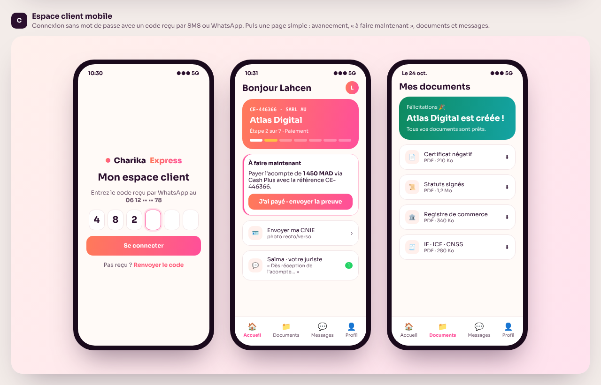

# Client space (client accounts)

Status: **proposal, not built yet.** Pick a model (A, B or C below) to start.

Each client gets their own account to follow their company creation. It is connected to the team space (`admin.html`): when a juriste moves a file to the next step, marks a payment as received or adds a document, the client sees it in their space.

## How it works

- **Account created automatically.** The request form (`demande.html`) already asks for the client's email and phone, so the account is created when the request is sent. The client fills in nothing extra.
- **Login without a password.** The client receives a one-time code by email, SMS or WhatsApp. Simpler for clients, and no forgotten passwords. A classic email and password login is also possible.
- **Each client sees only their own files.** Access is enforced by the database rules, not only by the page.

## What the client sees

- Where their file is in the 7 steps: Reçue → Paiement → Pièces → Certificat négatif → Statuts → RC · IF · CNSS → Livré.
- What they have to do now: pay, send their CNIE.
- Their payments: amount, reference, what is left to pay.
- Document upload (photo of the CNIE, payment proof), which goes straight into their file in the team space.
- Messages with their juriste.
- At the end, all their company documents to download: certificat négatif, statuts, RC, IF/ICE/CNSS.
- Later: other services, such as a change to the statuts or a domiciliation renewal.

## Models

Screenshots show example data only.

### A · Suivi de mon dossier

The 7-step tracker is the centre of the page, with the action to do inside the current step ("J'ai payé · envoyer la preuve"). The juriste, documents and order summary sit on the right.

### B · Tableau de bord client

A full space with a menu. Summary cards (progress, amount left to pay, documents sent), a drag-and-drop or photo upload area, messages with the juriste, and the company documents ready at the end.

### C · Espace client mobile

Login with a 6-digit code sent by WhatsApp. Then a simple screen with the progress, an "À faire maintenant" box, documents and messages. At the end, a "Félicitations, votre société est créée" screen with the downloads.

## What it needs before going live

- **A database: Supabase**, the same one as the team space (see the README). It also stores uploaded documents securely, in a private storage bucket, so each client sees only their own files.
- **Login by email code** is included in Supabase at no extra cost.
- **Codes by SMS or WhatsApp** need a paid SMS service (for example Twilio), roughly 0.5 to 1 MAD per code.

## Planned data, on top of the team space

- `clients`: one row per client account, linked to Supabase Auth (email, phone, name).
- `requests.client_id`: links each request to its client.
- `messages`: client ↔ juriste messages (separate from the internal team notes, which clients never see).
- Storage bucket `documents`: uploads from the client and final company documents from the team, readable only by that client and the team.

## Next steps

1. Choose a model: A, B or C.
2. Build it in demo mode, linked to the team space demo, like `admin.html`.
3. Connect Supabase so clients, team and documents are real and shared.
